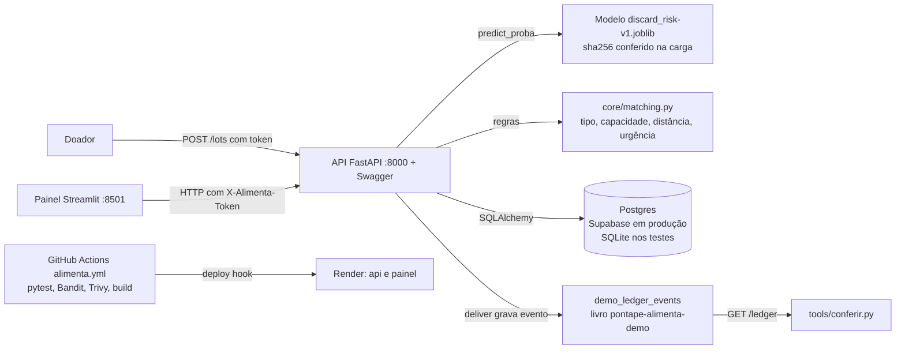

# Projeto integrador FIAP Rede Alimenta IA

> **DEMONSTRAÇÃO · dados simulados.** Nenhum doador, ONG, lote ou entrega deste módulo é real.

Este é o projeto integrador da FIAP "Rede Alimenta IA" (Tecnólogo em Inteligência Artificial, 1º ano, 2026). Dentro do PontaPé, o módulo se chama **Rede Alimenta**. Ele mora no passo 4 da escada, "Comida e roupa", que é o módulo M5 · Ponte inicial do [PRD](../PRD.md). No texto do PontaPé o termo é sempre AI.

Outros documentos desta pasta:

- [STRIDE.md](STRIDE.md): matriz de ameaças e riscos, com LGPD.
- [PITCH.md](PITCH.md): roteiro da apresentação e da demo de 5 a 7 minutos.
- [LIMITES.md](LIMITES.md): o que é simulado, o que é estimado e o que ainda não está pronto.

## Problema

O enunciado da FIAP descreve o paradoxo: comida é jogada fora enquanto muita gente passa fome. A missão pedida é usar AI para ligar o excedente de quem doa à necessidade real de ONGs, com foco em impacto social e logística urbana (enunciado `requisitos-fiap.pdf`, página 2).

Na prática, o lote de comida tem prazo. Se ninguém decide rápido para onde ele vai, ele estraga. Quem doa não sabe qual ONG aceita aquele tipo de comida, tem espaço naquele dia e está perto.

## Solução

A Rede Alimenta faz quatro coisas, nesta ordem:

1. O doador cadastra um lote: categoria, kg, validade, armazenamento e região.
2. Um modelo de AI estima a chance de o lote ser descartado sem uso. A tela mostra risco baixo, médio ou alto.
3. Regras de logística ordenam as ONGs: tipo de comida aceito, capacidade do dia, distância e urgência. Lote vencido é bloqueado.
4. A ONG escolhida confirma, coleta e entrega. Cada entrega vira um evento num livro com hash que qualquer pessoa confere.

O painel mostra o efeito: kg salvos, refeições estimadas por região, acurácia do modelo, tempo médio de match e a saúde do pipeline de segurança.

## Como rodar

### Com Docker (caminho do avaliador)

Na raiz do repositório:

```bash
docker compose up --build
```

Sobem três serviços: `db` (Postgres 16), `api` e `painel`. O seed simulado carrega sozinho na primeira subida.

| O quê | Endereço local |
|---|---|
| API e Swagger | http://localhost:8000/docs |
| Saúde da API | http://localhost:8000/health |
| Painel Streamlit | http://localhost:8501 |

Para voltar ao estado inicial antes de um ensaio:

```bash
curl -X POST http://localhost:8000/demo/reset -H "X-Alimenta-Token: $ALIMENTA_WRITE_TOKEN"
```

### Sem Docker, com uv

Requer Python 3.12 (a FIAP pede 3.10 ou mais) e [uv](https://docs.astral.sh/uv/). Sem `DATABASE_URL`, o banco é um SQLite local (`alimenta.db`).

```bash
cp alimenta/.env.example alimenta/.env              # defina ALIMENTA_WRITE_TOKEN
uv sync --project alimenta                           # instala as dependências fixadas no uv.lock
uv run --project alimenta python -m alimenta.data.generate   # gera o dataset simulado (seed 20261015)
uv run --project alimenta python -m alimenta.model.train     # treina, avalia e grava metrics.json
uv run --project alimenta uvicorn alimenta.api.main:app --port 8000
uv run --project alimenta streamlit run alimenta/painel/app.py --server.port 8501
uv run --project alimenta python -m pytest alimenta/tests
```

### Variáveis de ambiente

Documentadas em `alimenta/.env.example`. Segredo nunca entra no git.

| Variável | Para quê | Valor local |
|---|---|---|
| `DATABASE_URL` | Banco. SQLite nos testes, Postgres no compose, pooler do Supabase em produção | `sqlite:///./alimenta.db` |
| `ALIMENTA_WRITE_TOKEN` | Token exigido em toda escrita na API (cabeçalho `X-Alimenta-Token`) | qualquer texto longo e aleatório |
| `ALIMENTA_API_URL` | Endereço da API que o painel chama | `http://localhost:8000` |
| `ALIMENTA_SEED_ON_START` | Carrega o seed simulado na subida, sem duplicar | `true` |
| `ALIMENTA_MODEL_PATH` | Caminho do artefato do modelo | `alimenta/model/artifacts/discard_risk-v1.joblib` |
| `ALIMENTA_GITHUB_REPO` | Repositório lido para mostrar a saúde do pipeline | `LucasOl1337/pontape` |
| `PORT` | Porta do serviço no Render | definida pelo Render |

## Arquitetura



O painel nunca fala direto com o banco. Ele chama a API, então passa pelas mesmas regras (409 para lote já atribuído, 422 para lote vencido).

Estrutura do código (pasta `alimenta/` na raiz do repo):

| Caminho | O que tem |
|---|---|
| `alimenta/data/generate.py` | Gerador do dataset simulado, seed fixa `20261015` |
| `alimenta/data/lots_history.csv` | Histórico simulado de cerca de 6.000 lotes, rotulado, para treino |
| `alimenta/data/seed/` | Doadores, ONGs e lotes fictícios do seed operacional |
| `alimenta/data/DICIONARIO.md` | Campos, unidades, origem SIMULADO e como o rótulo nasce |
| `alimenta/model/train.py` | Split antes de ajustar, baselines, métricas |
| `alimenta/model/predict.py` | Carrega o artefato só depois de conferir o sha256 |
| `alimenta/model/artifacts/` | `discard_risk-v1.joblib` e `metrics.json` |
| `alimenta/core/matching.py` | Regras do match Doador × ONG |
| `alimenta/core/kpis.py` | Cálculo dos KPIs |
| `alimenta/db/` | Modelos SQLAlchemy e sessão; `create_all` e seed idempotente |
| `alimenta/ledger/demo_ledger.py` | Livro da demo |
| `alimenta/api/main.py` | API FastAPI |
| `alimenta/painel/app.py` | Painel Streamlit |
| `alimenta/seguranca/` | Relatórios Bandit e Trivy, linha de base e atuais |
| `alimenta/tests/` | Testes pytest com casos exatos |
| `alimenta/Dockerfile` | Uma imagem para api e painel, usuário não root |
| `docker-compose.yml` | `db`, `api` e `painel` |
| `.github/workflows/alimenta.yml` | Workflow "Rede Alimenta" |

Tabelas: `donors`, `ngos`, `lots`, `matches` e `demo_ledger_events`. Um índice único parcial em `matches.lot_id` (onde `status <> 'cancelled'`) impede no próprio banco que o mesmo lote vá para duas ONGs.

Rotas principais:

| Rota | Faz |
|---|---|
| `GET /health` | Saúde |
| `GET\|POST /donors`, `GET\|POST /ngos` | Cadastro de doadores e ONGs |
| `GET\|POST /lots`, `GET /lots/{id}` | Lotes. O POST prediz o risco; lote vencido volta 422 |
| `GET /lots/{id}/recommendations` | Ranking de ONGs com os pontos de cada regra |
| `POST /lots/{id}/matches` | Escolhe a ONG. Volta 409 se o lote já tem match ativo |
| `POST /matches/{id}/confirm\|collect\|deliver\|cancel` | Ciclo do match. `deliver` é idempotente e grava o evento no livro da demo |
| `GET /kpis` | KPIs do painel |
| `GET /model` | Versão, sha256 e métricas do modelo |
| `GET /ledger`, `GET /ledger/verify` | Livro da demo e conferência |
| `POST /demo/reset` | Volta ao seed, com token |

## Requisito FIAP e onde está a prova

Coluna "Prova" diz o que rodar ou abrir. As URLs públicas só existem depois do deploy feito pelo regente.

| Requisito FIAP | Arquivo ou rota | Prova |
|---|---|---|
| Dataset estruturado (público ou simulado) | `alimenta/data/lots_history.csv`, `alimenta/data/seed/`, `alimenta/data/DICIONARIO.md` | `uv run --project alimenta python -m alimenta.data.generate` gera o mesmo arquivo com a seed `20261015` |
| Modelo funcional local (scikit-learn) | `alimenta/model/train.py`, `alimenta/model/artifacts/discard_risk-v1.joblib`, `metrics.json` | `uv run --project alimenta python -m alimenta.model.train`; `GET /model` |
| Priorização de lotes | Campo `risk_level` do lote, alertas de validade no painel | `POST /lots` devolve `discard_proba` e `risk_level` |
| Recomendação geográfica, Doador × ONG | `alimenta/core/matching.py` | `GET /lots/{id}/recommendations` |
| Otimização de rotas de coleta | `GET /ngos/{id}/route` (vizinho mais próximo) | [preencher: entra só se ficar pronto; ver LIMITES.md] |
| Análise semântica de validade e tipo (Hugging Face) | Não implementada | Ver [LIMITES.md](LIMITES.md) |
| FastAPI com Swagger | `alimenta/api/main.py` | http://localhost:8000/docs; URL pública [preencher após deploy]/docs |
| Frontend Streamlit | `alimenta/painel/app.py` | http://localhost:8501; URL pública [preencher após deploy] |
| Matriz STRIDE | [STRIDE.md](STRIDE.md) | Leitura |
| Dockerfile e Compose | `alimenta/Dockerfile`, `docker-compose.yml`, `.dockerignore` | `docker compose up --build` na raiz |
| Pipeline GitHub Actions CI/CD | `.github/workflows/alimenta.yml` | Execução verde na main: [preencher após deploy: link da execução e commit] |
| Relatórios SAST Bandit e Trivy | Artefatos do workflow; `alimenta/seguranca/` | Jobs `bandit`, `trivy-fs` e `imagem` |
| URL pública (Render) | `render.yaml` | API: [preencher após deploy]. Painel: [preencher após deploy] |
| Banco em nuvem (Supabase) | `DATABASE_URL` com o pooler do Supabase | Criar um lote, recarregar o painel, o lote continua lá |
| Persistência após recarga | Postgres | Mesmo teste acima, no compose e no Render |
| Impedir dupla atribuição | Índice único parcial em `matches.lot_id` | Segundo `POST /lots/{id}/matches` volta 409; teste em `alimenta/tests/` |
| Bloquear lote vencido | `alimenta/core/matching.py`, `POST /lots` | `POST /lots` com validade no passado volta 422 |
| Dashboard com KPIs | `alimenta/painel/app.py`, `GET /kpis` | Seção KPIs abaixo |
| Mapa de calor por região | Painel | Aba do mapa, legenda "DEMONSTRAÇÃO · dados simulados" |
| Alertas de validade crítica | Painel | Lista de lotes com validade curta e risco alto |
| LGPD | [STRIDE.md](STRIDE.md), seção LGPD | Nenhum dado pessoal; tudo fictício |
| README completo | Este arquivo | Leitura |
| Pitch final | [PITCH.md](PITCH.md) | Ensaio de 5 a 7 minutos |

## KPIs e como cada um é calculado

Todo número do painel é de demonstração. Nenhum é impacto social real.

| KPI | Definição exata | Quando vazio |
|---|---|---|
| kg salvos | Soma do peso dos lotes com match no estado `delivered`. Um lote conta uma vez, mesmo que tenha tido outro match cancelado | 0 |
| Refeições estimadas por região | kg entregues na região da ONG dividido por 0,544 kg por refeição. Sempre com a palavra "estimadas" | 0 |
| Acurácia do modelo | Acertos dividido pelo total de exemplos do teste reservado. Aparece com o tamanho da amostra, a versão do modelo e a matriz de confusão | Não se aplica |
| Tempo médio de match | Média de `match.confirmed_at` menos `lot.published_at`, só para matches confirmados. Mede quanto a ONG demorou para aceitar. Não é a latência da API | "sem dados" |
| Vulnerabilidades mitigadas | Achados do primeiro scan real (linha de base, commit registrado em `alimenta/seguranca/baseline/`) que não aparecem no scan atual, por identificador | "0 mitigadas, 0 abertas", com data e commit |
| Saúde do pipeline e gates | Status da última execução do workflow na main: aprovado, reprovado ou não executado, com data e commit. Lido da API pública do GitHub, com cache de 10 min | "não executado" |

O fator de 0,544 kg por refeição vem da Feeding America: "each meal is roughly 1.2 pounds" ([About our claims](https://www.feedingamerica.org/ways-to-give/faq/about-our-claims), acesso em 14/10/2026). É uma estimativa dos Estados Unidos. Ver [LIMITES.md](LIMITES.md).

A região das refeições é a região da ONG, onde a fome foi atendida, e não a do doador.

## Modelo de AI

### O que ele prevê

Alvo binário `discarded`: o lote foi descartado sem aproveitamento (1) ou não (0).

O rótulo é simulado. O gerador calcula, para cada lote, uma probabilidade escondida que combina horas até vencer, armazenamento, perecibilidade da categoria, kg, hora do dia e demanda da região. Depois sorteia o rótulo dessa probabilidade, com ruído. O processo completo está em `alimenta/data/DICIONARIO.md`.

O rótulo não sai de uma regra de prazo. Se saísse, o modelo só copiaria a regra e a acurácia não provaria nada.

### Como treina

1. Split estratificado treino/teste **antes** de qualquer ajuste. O teste fica guardado até o fim.
2. Modelo principal: `HistGradientBoostingClassifier`. Comparação: `LogisticRegression`.
3. Duas baselines no mesmo teste:
   - classe majoritária (chuta sempre a classe mais comum);
   - regra só de prazo (descarta se faltam poucas horas para vencer).
4. O modelo precisa vencer as duas baselines no teste reservado.
5. O CI retreina com a mesma seed e compara com o `metrics.json` versionado.

A tela mostra risco baixo, médio ou alto. Isso é só um limiar sobre a probabilidade do modelo, não outro modelo.

### Métricas

Valores lidos de `alimenta/model/artifacts/metrics.json`. Preencher depois do treino final.

| Métrica | Modelo `discard_risk-v1` | Baseline majoritária | Baseline de prazo |
|---|---|---|---|
| Acurácia no teste | [metrics.json] | [metrics.json] | [metrics.json] |
| Precisão, classe `discarded` | [metrics.json] | [metrics.json] | [metrics.json] |
| Recall, classe `discarded` | [metrics.json] | [metrics.json] | [metrics.json] |
| F1, classe `discarded` | [metrics.json] | [metrics.json] | [metrics.json] |

- Tamanho do teste: [metrics.json: n_test] lotes. Treino: [metrics.json: n_train] lotes.
- Matriz de confusão do modelo: [metrics.json: confusion_matrix].
- sha256 do artefato: [metrics.json: sha256].

Acurácia sozinha engana quando uma classe é rara. Por isso a tabela traz recall e a matriz de confusão.

### O que é modelo e o que é regra

| Parte | Tipo |
|---|---|
| Probabilidade de descarte (`discard_proba`) | Modelo aprendido |
| Faixa baixo, médio ou alto | Limiar fixo sobre a probabilidade |
| Bloqueio de lote vencido | Regra fixa. Nenhum modelo decide se comida vencida pode ser doada |
| Tipo de comida aceito pela ONG | Regra fixa |
| Capacidade da ONG no dia | Regra fixa |
| Distância (haversine) | Cálculo |
| Urgência no ranking | Regra que usa o risco do modelo e as horas até vencer |
| Rota de coleta | Heurística de vizinho mais próximo, se entrar |

A previsão não é certificado sanitário. Ela só ajuda a decidir a ordem.

## Livro da demo `pontape-alimenta-demo`

Cada entrega confirmada (`POST /matches/{id}/deliver`) grava um evento num livro com hash encadeado. É o mesmo método do livro público do PontaPé: JSON canônico JCS ([RFC 8785](https://www.rfc-editor.org/rfc/rfc8785), acesso em 14/10/2026) e SHA-256, conforme [CONTRATO.md](../transparencia/CONTRATO.md).

Regras:

- O livro da demo é **separado** do livro real. Mora só na tabela `demo_ledger_events` e no download `GET /ledger`.
- O livro real do PontaPé não recebe nenhum evento simulado. A regra "doação fictícia não entra no livro real" está na D040 ([DECISOES.md](../DECISOES.md)).
- O evento segue o contrato v1 sem mudar nada: família `field`, ação `food_delivered`, `quantity` em **gramas**. Sem doador, ONG, região ou lote no evento. kg por região fica só no banco.
- O download vem como `{notice, events}`. O `notice` diz "DEMONSTRAÇÃO · dados simulados · Rede Alimenta · quantity em gramas · não é o livro real do PontaPé".
- O livro da demo não tem checkpoint. O conferidor só aceita checkpoint com o nome do livro real, então o nome `pontape-alimenta-demo` aparece no `notice` e no painel.

Como conferir com o mesmo conferidor do público (Python, só biblioteca padrão):

```bash
curl -s http://localhost:8000/ledger -o livro-demo.json
python3 tools/conferir.py livro-demo.json
# Tudo certo: N ações, nada apagado nem mudado
```

Para ver a quebra: troque um `quantity` no arquivo e rode de novo. O conferidor aponta a linha alterada. A aba "Conferir livro da demo" do painel roda a mesma função `verify` de `tools/conferir.py`.

## Segurança e DevSecOps

Workflow `.github/workflows/alimenta.yml` ("Rede Alimenta"). Roda em todo PR e em todo push na main, sem filtro de caminho. Assim o commit mostrado na banca sempre tem uma execução. Permissão `contents: read`. O CI antigo (`ci.yml`) continua igual.

| Job | Faz | Gate (reprova quando) |
|---|---|---|
| `testes` | `uv sync`, pytest, retreino com a mesma seed comparado ao `metrics.json` | Algum teste falha ou as métricas mudam |
| `bandit` | Análise estática do código Python, relatório JSON e texto como artefato | Achado com severidade e confiança MEDIUM ou maior |
| `trivy-fs` | Trivy em dependências (fs) e em configuração (Dockerfile, compose) | HIGH ou CRITICAL com correção disponível (`--ignore-unfixed`) |
| `imagem` | `docker build` e `trivy image`, relatório SARIF/JSON como artefato | HIGH ou CRITICAL com correção disponível |
| `deploy` | Chama os deploy hooks do Render | Só na main e só se o segredo existe. Sem segredo, pula e registra "não executado" |

Achado aceito de propósito vai para `.trivyignore` ou `# nosec`, com justificativa, e aparece na [STRIDE.md](STRIDE.md).

O Trivy é instalado por binário de versão fixa (v0.76.0) com checksum conferido, nunca por tag móvel de Action. Motivo: em 19/03/2026 a cadeia do Trivy foi comprometida. Saiu uma release maliciosa v0.69.4 e 76 de 77 tags do `aquasecurity/trivy-action` foram repontadas para código que roubava credenciais ([GHSA-69fq-xp46-6x23](https://github.com/aquasecurity/trivy/security/advisories/GHSA-69fq-xp46-6x23), acesso em 14/10/2026).

"Vulnerabilidades mitigadas" no painel compara o primeiro scan real com o atual, por identificador. Ninguém plantou falha para mostrar redução. Se o primeiro scan veio limpo, o painel mostra zero, com data e commit.

Linha de base: commit [preencher], data [preencher]. Achados na linha de base: [preencher]. Achados no scan atual: [preencher].

Outras proteções:

- Toda escrita na API exige `X-Alimenta-Token`. Leitura é aberta.
- O painel guarda o token no servidor e nunca no navegador.
- O artefato do modelo só carrega se o sha256 bate com o `metrics.json`.
- A imagem roda com usuário não root.
- Segredos só em variável de ambiente. `alimenta/.env.example` documenta as chaves sem valor.

## Deploy

Alvo: Render (API e painel, dois web services da mesma imagem, `render.yaml`) e Supabase Postgres.

- O projeto Supabase `rede-alimenta` está em **us-east-1**. A região ideal seria **sa-east-1** (São Paulo), mas o pooler de sa-east-1 não respondeu na criação.
- A API conecta pelo Supavisor pooler, modo sessão, porta 5432. Render e GitHub Actions só têm IPv4, e a conexão direta do Supabase é IPv6 ([Supabase, IPv4 e IPv6](https://supabase.com/docs/guides/troubleshooting/supabase--your-network-ipv4-and-ipv6-compatibility-cHe3BP), acesso em 14/10/2026).
- Quem cria conta, segredo e serviço é o regente. Segredos do GitHub: `RENDER_DEPLOY_HOOK_API` e `RENDER_DEPLOY_HOOK_PAINEL`.

URLs públicas:

- API e Swagger: [preencher após deploy]
- Painel: [preencher após deploy]
- Execução do CI demonstrada: [preencher após deploy]

## Limitações

Resumo. A lista completa está em [LIMITES.md](LIMITES.md).

- Tudo é simulado: doadores, ONGs, lotes, histórico e rótulo de descarte.
- Refeições são estimativa com fator dos Estados Unidos.
- Rota de coleta e análise semântica com Hugging Face podem não estar prontas.
- No plano free, o Render dorme após 15 minutos parado e o Supabase pausa após 1 semana parado.
- O livro da demo tem hash, mas ainda não tem assinatura nem carimbo público.

## Integrantes

| Nome | RM | Frente |
|---|---|---|
| [nome] | [RM] | [frente] |
| [nome] | [RM] | [frente] |
| [nome] | [RM] | [frente] |

O site pontape.org não nomeia ninguém (D036). Os nomes aparecem só aqui, na entrega acadêmica.
