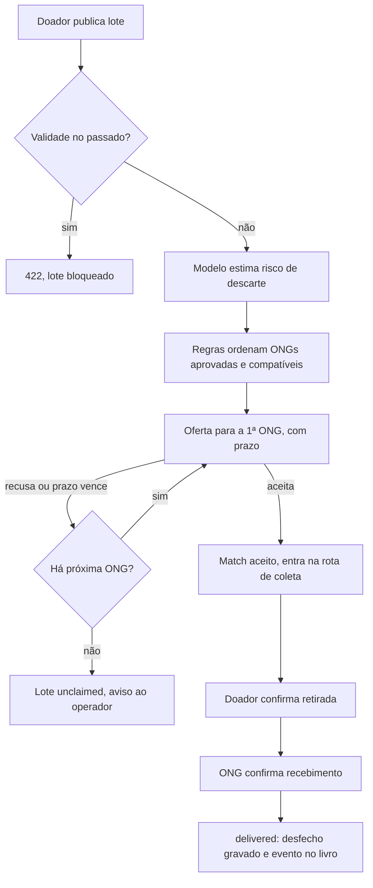
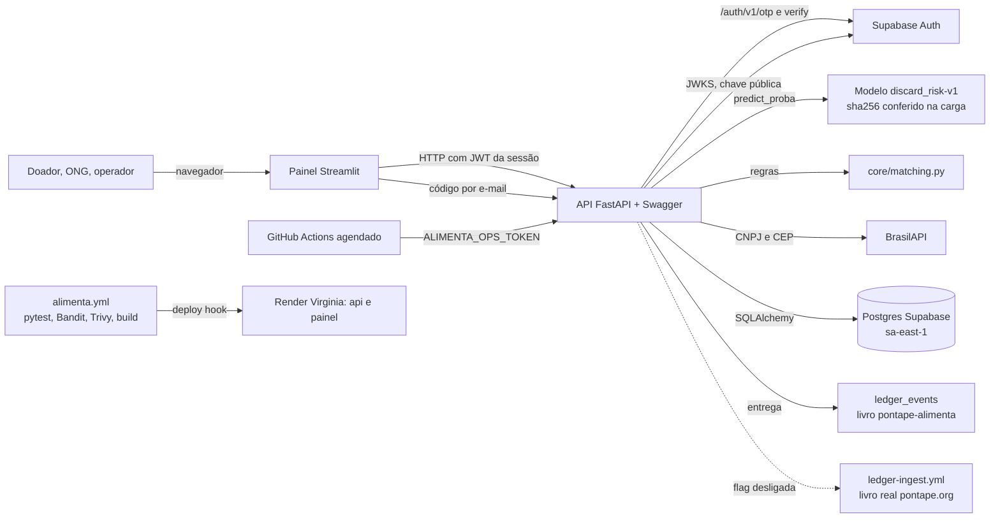

# Rede Alimenta

Projeto integrador FIAP "Rede Alimenta IA" (tecnólogo, 1º ano, 2026). Dentro do PontaPé, o módulo se chama **Rede Alimenta**. Ele mora no passo 4 da escada, "Comida e roupa", que é o módulo M5 · Ponte inicial do [PRD](../PRD.md). No texto do PontaPé o termo é sempre AI.

A Rede Alimenta é um sistema real. Ela recebe doações de comida de estabelecimentos com CNPJ e distribui para ONGs aprovadas, com AI para priorizar e regras para decidir quem recebe. A produção começa com o banco vazio. O painel público mostra zero até a primeira entrega real.

Estado em 14/10/2026:

- O cadastro de doadores e ONGs reais está **fechado** (`ALIMENTA_SIGNUP_OPEN=false`). Motivo: a D012 proíbe guardar dado pessoal antes de existir um controlador legal dos dados ([DECISOES.md](../DECISOES.md)). O sistema fica pronto e fechado até o Lucas aprovar os textos legais.
- O operador e as contas de teste do time continuam funcionando.
- Dado sintético só existe em três lugares: a partida a frio do modelo, os testes e o `docker compose` local. Nunca na produção.
- O corte real está na branch `alimenta/real`. Cada afirmação aponta para o teste em `alimenta/tests/` que a prova.

Outros documentos desta pasta:

- [STRIDE.md](STRIDE.md): ameaças do sistema real, mitigação, evidência e LGPD.
- [PITCH.md](PITCH.md): roteiro da apresentação de 5 a 7 minutos, com o ensaio por contas de teste.
- [LIMITES.md](LIMITES.md): o que o sistema ainda não faz, o que é estimativa e onde o dado passa fora do Brasil.

## Problema

O enunciado da FIAP descreve o paradoxo: comida é jogada fora enquanto muita gente passa fome. A missão é usar AI para ligar o excedente de quem doa à necessidade real de ONGs, com foco em impacto social e logística urbana (`requisitos-fiap.pdf`, página 2).

Um lote de comida tem prazo. Se ninguém decide rápido para onde ele vai, ele estraga. Quem doa não sabe qual ONG aceita aquele tipo de comida, tem espaço naquele dia e está perto.

## Papéis

Uma conta é um papel e uma organização. Ninguém escolhe ser operador.

| Papel | Quem é | O que faz |
|---|---|---|
| `donor` (doador) | Estabelecimento com CNPJ: mercado, padaria, restaurante, produtor com empresa | Cadastra a empresa e o endereço de retirada, publica lotes, confirma a retirada |
| `ngo` (ONG) | Organização receptora com CNPJ | Cadastra capacidade, tipos de comida aceitos, refrigeração, janela e raio de coleta. Recebe ofertas, aceita ou recusa, faz a rota de coleta, confirma o recebimento. Só opera depois de aprovada |
| `operator` (operador) | Equipe do PontaPé | Aprova, recusa ou suspende ONGs, vê a visão geral, reoferta lotes sem ONG, lê a auditoria |

O operador vem da variável `ALIMENTA_OPERATOR_EMAILS`, posta no Render pelo regente. Hoje só o e-mail do Lucas está nela. O padrão é negar: rota sem papel certo devolve 403 ([ARQUITETURA.md](../arquitetura/ARQUITETURA.md) §6).

No lançamento, o doador precisa de CNPJ. A Lei 14.016/2020 autoriza a doação por "estabelecimentos" (art. 1º), e só CNPJ guarda menos dado pessoal. CPF de produtor rural fica na fila.

A área atendida no lançamento é só a cidade de São Paulo (código IBGE 3550308). O modelo conhece 5 macrorregiões da capital. Endereço fora dela recebe "ainda não atendemos".

## Login

O login usa Supabase Auth com **código de 6 dígitos enviado por e-mail**. Não há senha.

1. A pessoa digita o e-mail no painel. O painel chama `POST /auth/code`, e a API pede o código ao Supabase.
2. A pessoa digita o código. O painel chama `POST /auth/verify` e recebe a sessão.
3. O painel guarda o JWT só na sessão do servidor (`st.session_state`). Ele não vai para o navegador.
4. A cada chamada, o FastAPI valida o JWT com a chave pública do projeto (`/auth/v1/.well-known/jwks.json`), conferindo `iss`, `aud=authenticated`, `exp` e `sub`.

Código e não link: o Streamlit não consegue ler o fragmento `#access_token` de um redirect. Fontes: [Supabase JWT](https://supabase.com/docs/guides/auth/jwts) e [JWT Signing Keys](https://supabase.com/blog/jwt-signing-keys), acesso em 14/10/2026.

O e-mail do código sai pelo SMTP padrão do Supabase. Ele só envia para membros do time do projeto e tem limite de cerca de 2 e-mails por hora ([Custom SMTP](https://supabase.com/docs/guides/auth/auth-smtp) e [Rate limits](https://supabase.com/docs/guides/auth/rate-limits), acesso em 14/10/2026). Para abrir a doadores e ONGs de fora, falta um SMTP próprio (Resend ou Brevo, remetente `@pontape.org`). Ver [LIMITES.md](LIMITES.md).

O antigo token único de escrita (`X-Alimenta-Token`) deixa de ser caminho de usuário. Ele vira `ALIMENTA_OPS_TOKEN` e só vale em `POST /ops/sweep`, a rota da automação. Prova: `test_auth.py::test_ops_token_only_on_sweep`.

## Cadastro e verificação

Todo cadastro começa com o aceite do aviso de privacidade. O doador aceita também o termo de doação. Cada aceite vira uma linha em `consents` (tipo, versão, data), só com INSERT. Os dois textos estão marcados "rascunho para revisão" até o Lucas aprovar.

**Doador.** Razão social, nome fantasia, CNPJ, nome de contato, telefone, CEP, número e horários de retirada.

**ONG.** CNPJ, endereço, capacidade por dia, tipos de comida aceitos, se aceita refrigerado e congelado, janela de recebimento e raio de coleta. A ONG entra como `pending` e só recebe oferta depois de `approved`.

**CNPJ.** A API consulta a BrasilAPI (`GET /api/cnpj/v1/{cnpj}`) e guarda a resposta em `ngos.cnpj_check`.

- Situação cadastral `ATIVA` é obrigatória.
- Natureza jurídica do grupo 3xx (associação privada, fundação privada, organização religiosa) marca "confere".
- Qualquer outro caso vai ao operador com alerta.
- A aprovação é sempre humana. A consulta só ajuda o operador.

A Receita emite CNPJ alfanumérico desde 31/07/2026 ([Receita Federal](https://www.gov.br/receitafederal/pt-br/assuntos/noticias/2026/julho/receita-federal-gera-o-primeiro-cnpj-em-formato-alfanumerico), acesso em 14/10/2026). A validação local aceita o formato novo. Se a BrasilAPI não responder para ele, o cadastro cai em revisão manual. Fonte da API: [BrasilAPI](https://brasilapi.com.br/docs), acesso em 14/10/2026.

**CEP.** A API consulta a BrasilAPI (`GET /api/cep/v2/{cep}`), com cache, pela rota de apoio `GET /geo/cep/{cep}`. A resposta traz o endereço e, quase sempre, `location.coordinates`. Quando o CEP vem sem coordenada, o cadastro pede confirmação e o operador ajusta. A coluna `geo_source` guarda de onde veio a coordenada. A região do modelo é a macrorregião de centroide mais perto.

## Fluxo de uma doação



1. **Publicar.** O doador informa categoria, kg, validade, armazenamento, janela de retirada (`pickup_from`, `pickup_until`) e se ele mesmo entrega (`delivery_mode`). Ele marca a caixa "dentro da validade e conservado como o fabricante manda" em todo lote. Lote vencido volta 422.
2. **Prever.** O modelo estima `discard_proba`. A tela mostra risco baixo, médio ou alto. As entradas do modelo ficam congeladas em `lots.features`.
3. **Recomendar.** Entram só ONGs `approved` que aceitam a categoria, têm refrigeração quando o lote pede, estão dentro do próprio raio de coleta, têm janela que cruza a retirada, têm capacidade no dia e não recusaram este lote. A ordem soma distância, capacidade e urgência.
4. **Ofertar.** Uma oferta por vez, em `lot_offers`. Um índice único parcial garante uma só oferta `pending` por lote.
5. **Aceitar ou recusar.** A ONG aceita (`POST /offers/{id}/accept`) ou recusa com motivo de uma lista fechada.
6. **Coletar.** A ONG retira. A rota de coleta ordena as paradas.
7. **Confirmar duas vezes.** O doador confirma a retirada (`POST /matches/{id}/pickup`). A ONG confirma o recebimento (`POST /matches/{id}/receipt`). Cada confirmação é uma linha em `confirmations`, única por match e tipo. O lote só vira `delivered` com as duas.

Estados do lote: `open → offered → accepted → collected → delivered`. Saídas sem entrega: `expired`, `unclaimed`, `cancelled`.

### Escalonamento

O prazo de resposta de cada oferta é `respond_by = agora + 25% das horas até vencer`, com mínimo de 15 e máximo de 60 minutos.

- Se a ONG recusa ou o prazo vence, a oferta vai para a próxima ONG do ranking.
- Se não há próxima, o lote fica `unclaimed` e o operador é avisado.
- Se o lote passa da validade, ele fica `expired`.

A checagem roda a cada leitura e na rota `POST /ops/sweep`. Um workflow agendado do GitHub Actions chama a varredura a cada 30 minutos, das 7h às 22h. Fora desse horário a checagem só acontece quando alguém abre o sistema. Motivo: no Render free, 750 horas por mês valem para o workspace inteiro ([Render Free](https://render.com/docs/free), acesso em 14/10/2026). Workflow `.github/workflows/alimenta-varredura.yml`. Provas: `test_fluxo.py::test_timeout_escalates_by_sweep` e `test_fluxo.py::test_decline_escalates_then_unclaimed`.

### Aviso às ONGs

- Caixa de ofertas no painel da ONG, sempre.
- Link `https://wa.me/55DDDNUMERO?text=...` gerado para o operador ou o doador tocar e enviar ([WhatsApp click to chat](https://faq.whatsapp.com/general/chats/how-to-use-click-to-chat), acesso em 14/10/2026). Grátis, sem API paga e sem envio automático.
- E-mail pelo mesmo SMTP do login, quando houver SMTP próprio.

O aviso traz categoria, kg, prazo e bairro. Nunca traz beneficiário. Cada aviso vira uma linha em `notifications`.

### Rota de coleta

A rota nasceu no corte 1 (merge `f57f4b0`, testes em `alimenta/tests/test_route.py`). No corte real ela só existe para a ONG logada. Ela sai da ONG, vai sempre ao doador mais perto ainda não visitado e volta à ONG. Lotes do mesmo doador viram uma parada. A distância é haversine, em linha reta. É uma heurística gulosa de vizinho mais próximo e não garante a menor rota.

No corte real, a ONG logada vê a própria rota em `GET /ngos/me/route`. Prova: `test_fluxo.py::test_full_flow_double_confirmation`.

## Livro público

Cada entrega com dupla confirmação grava um evento num livro com hash encadeado. É o mesmo método do livro do PontaPé: JSON canônico JCS ([RFC 8785](https://www.rfc-editor.org/rfc/rfc8785), acesso em 14/10/2026) e SHA-256, conforme o [CONTRATO.md](../transparencia/CONTRATO.md).

São duas camadas.

**Livro próprio `pontape-alimenta` (ligado).** Mora na tabela `ledger_events`, antes `demo_ledger_events`. O evento segue o contrato v1 sem mudança: família `field`, ação `food_delivered`, `quantity` em **gramas**. O evento não tem doador, ONG, região, lote nem endereço. O kg por região fica só no banco. Qualquer pessoa baixa e confere:

```bash
curl -s https://rede-alimenta-api-u5q4.onrender.com/ledger -o livro.json
python3 tools/conferir.py livro.json
# Tudo certo: N ações, nada apagado nem mudado
```

O conferidor é o mesmo do livro público, em Python, só com biblioteca padrão. Para ver a quebra, troque um `quantity` no arquivo e rode de novo. O conferidor aponta a linha alterada. Em produção vazia, o livro tem zero eventos.

**Publicação no livro real de pontape.org (pronta, desligada).** A API pode mandar um evento `field.food_delivered` para o workflow `ledger-ingest.yml` do repositório. O livro real tem assinatura Ed25519 e carimbo no Rekor e na freetsa (D040). Regras:

- Fica desligada pela flag `ALIMENTA_PUBLISH_REAL_LEDGER=false` até o Lucas autorizar a primeira publicação.
- `quantity: "1"` por entrega, nunca gramas. O site lê `quantity` da família `field` como número de entregas (`src/lib/ledger-view/phrases.ts`).
- `eventId` estável (`delivery-<match_id>`), para que um retry não duplique.
- Cada envio vira uma linha em `public_ledger_dispatches`.
- Registro de teste (`is_test=true`) nunca entra em nenhum dos dois livros.

Feito: fonte `alimenta` em `src/lib/ledger/ingest.ts` (com teste em `ingest.test.ts`) e cliente em `alimenta/ledger/public.py`. Provas: `test_livro.py::test_flag_off_makes_no_network_call` e `test_livro.py::test_flag_on_dispatches_workflow_once`.

## Modelo de AI

### O que ele prevê

Alvo binário `discarded`: o lote foi descartado sem aproveitamento (1) ou não (0).

### Partida a frio com dado sintético

Ainda não existe histórico real de doações. Por isso o modelo atual `discard_risk-v1` foi **treinado com dado sintético**. Isso é uma partida a frio, e o sistema diz isso em `GET /model` e no painel.

O gerador `alimenta/data/generate.py` (seed fixa `20261015`) calcula, para cada lote, uma probabilidade escondida. Ela combina horas até vencer, armazenamento, perecibilidade da categoria, kg, hora do dia, fim de semana e demanda da região. Depois o gerador sorteia o rótulo dessa probabilidade, com ruído. O processo completo está em `alimenta/data/DICIONARIO.md`. O rótulo não sai de uma regra de prazo. Se saísse, o modelo só copiaria a regra.

### Retreino com dado real

Cada lote real grava as entradas do modelo congeladas (`lots.features`) e, no fim, o desfecho em `lot_outcomes`: `delivered`, `expired`, `unclaimed` ou `cancelled`. O rótulo de retreino é `discarded = desfecho em (expired, unclaimed)`. Lote `cancelled` não entra no rótulo.

O retreino com dado real (`python -m alimenta.model.train --source real`) só roda quando houver volume. Proposta: 300 desfechos e as duas classes com 50 ou mais. Registros `is_test=true` ficam de fora. A tabela é `lot_outcomes`, gravada em `delivered`, `unclaimed` e `expired`. Provas: `test_fluxo.py::test_full_flow_double_confirmation` e `test_fluxo.py::test_expired_lot_closes_on_sweep`.

### Como treina

1. Split estratificado 80/20 **antes** de qualquer ajuste: 4.800 lotes de treino e 1.200 de teste.
2. Modelo principal: `HistGradientBoostingClassifier`, escolhido antes de olhar o teste. `LogisticRegression` entra só como comparação.
3. Duas baselines no mesmo teste: classe majoritária (sempre "não descartado") e regra só de prazo (descartado se faltam 30,7 horas ou menos, limiar escolhido só com o treino).
4. O modelo precisa vencer as duas baselines (`beats_baselines: true` no `metrics.json`).
5. `python -m alimenta.model.train --check` retreina com a mesma seed e compara com o `metrics.json` versionado. O CI roda esse passo.

Entradas: `category`, `storage`, `region`, `kg`, `hours_to_expiry`, `published_hour`, `weekday`.

A tela mostra risco baixo (menor que 0,33), médio (de 0,33 a menos de 0,66) ou alto (0,66 ou mais). É um limiar sobre a probabilidade, não outro modelo.

### Métricas da partida a frio

Valores de `alimenta/model/artifacts/metrics.json`, commit `55280f4`, 14/10/2026. Todos medidos em dado sintético.

| Métrica no teste (1.200 lotes) | Modelo `discard_risk-v1` | Baseline majoritária | Baseline de prazo |
|---|---|---|---|
| Acurácia | 0,789 | 0,581 | 0,722 |
| Precisão, classe `discarded` | 0,778 | 0,000 | 0,680 |
| Recall, classe `discarded` | 0,696 | 0,000 | 0,634 |
| F1, classe `discarded` | 0,735 | 0,000 | 0,656 |

- ROC AUC: 0,855.
- Matriz de confusão (linha = verdade, coluna = previsão; ordem "não descartado", "descartado"): `[[597, 100], [153, 350]]`.
- Teto prático: quem conhecesse a probabilidade escondida, sem o ruído, acertaria 79,9% no mesmo teste. Acurácia perto de 100% seria sinal de vazamento.
- sha256 do artefato: `830dbe466ca635a4b8b5446b8f03888183ac512d2a06971cfbe60dd622af03d1`.
- Versões: Python 3.12.14, scikit-learn 1.9.1, pandas 3.0.6, numpy 2.5.4.

Estes números provam que o pipeline de treino e avaliação está certo. Eles não dizem quanto o modelo acerta com doações reais. Isso só se mede depois do retreino.

### O que é modelo e o que é regra

| Parte | Tipo |
|---|---|
| Probabilidade de descarte (`discard_proba`) | Modelo aprendido |
| Faixa baixo, médio ou alto | Limiar fixo (0,33 e 0,66) |
| Bloqueio de lote vencido | Regra fixa. Nenhum modelo decide se comida vencida pode ser doada |
| ONG aprovada, tipo aceito, refrigeração, raio, janela, capacidade | Regra fixa |
| Distância (haversine) | Cálculo |
| Urgência no ranking | Regra que usa o risco do modelo e as horas até vencer |
| Prazo da oferta e escalonamento | Regra fixa |
| Rota de coleta | Heurística de vizinho mais próximo |
| Aprovação de ONG | Decisão humana do operador |

A previsão não é certificado sanitário. Ela só ajuda a decidir a ordem.

## Lei e LGPD

**Lei 14.016/2020** ([Planalto](https://www.planalto.gov.br/ccivil_03/_ato2019-2022/2020/lei/l14016.htm), acesso em 14/10/2026):

- Art. 1º, I e II: o excedente pode ser doado se estiver dentro da validade, nas condições de conservação do fabricante, e sem risco à segurança sanitária.
- Art. 1º, § 3º: a doação é gratuita.
- Art. 2º: os beneficiários são pessoas ou grupos em vulnerabilidade ou risco alimentar.
- Art. 3º: doador e intermediário só respondem civil e administrativamente se agirem com dolo. A responsabilidade do doador acaba na primeira entrega ao intermediário (§ 1º).

No sistema isso vira: termo de doação versionado aceito no cadastro, caixa de conferência em todo lote, bloqueio de lote vencido (422) e dupla confirmação, que marca a primeira entrega à ONG.

**LGPD** ([Lei 13.709/2018](https://www.planalto.gov.br/ccivil_03/_ato2015-2018/2018/lei/l13709compilado.htm), acesso em 14/10/2026):

- Base legal para doador e ONG: execução de contrato a pedido do titular (art. 7º, V).
- Dado pessoal mínimo: nome de contato, e-mail e telefone da organização. Doador só com CNPJ.
- Nenhum dado de beneficiário final, em lugar nenhum.
- Endereço e coordenada nunca saem em rota pública. Só o próprio dono, a ONG com oferta daquele lote e o operador veem.
- Dado pessoal real nunca vai para Git, CI, seed ou print ([ARQUITETURA.md](../arquitetura/ARQUITETURA.md) §6).
- **D012:** sem controlador legal definido, nenhum cadastro real é aceito. Por isso `ALIMENTA_SIGNUP_OPEN=false` em produção. Os textos `termo-de-doacao-v1` e `aviso-de-privacidade-v1` estão marcados "rascunho para revisão". Os arquivos são `alimenta/legal/termo-de-doacao-v1.md` e `alimenta/legal/aviso-de-privacidade-v1.md`, servidos em `GET /legal/donation_terms` e `GET /legal/privacy_notice`.

A matriz de ameaças e o tratamento de cada dado estão em [STRIDE.md](STRIDE.md).

## Painel

Streamlit, um serviço só, com quatro visões. O painel nunca fala direto com o banco. Ele chama a API, então passa pelas mesmas regras e pelo mesmo controle de papel.

| Visão | Quem vê | O que tem |
|---|---|---|
| Pública, sem login | Qualquer pessoa | KPIs reais, mapa de calor por região, alertas de validade em agregado, saúde do CI, vulnerabilidades, "Conferir livro". Zero honesto em produção vazia |
| Doador | Conta `donor` | Cadastro (CEP preenche o endereço), publicar lote, meus lotes com situação, confirmar retirada, link de WhatsApp para a ONG |
| ONG | Conta `ngo` | Cadastro (CNPJ conferido na hora, aguarda aprovação), ofertas com prazo, aceitar ou recusar com motivo, rota de coleta, confirmar recebimento |
| Operador | Conta `operator` | ONGs pendentes com o retrato do CNPJ, aprovar, recusar ou suspender, visão geral, lotes sem ONG, reoferta, auditoria |

O painel tem as três telas. Provas: `test_painel.py::test_full_flow_through_panel` e `test_painel.py::test_operator_approves_pending_ngo`.

## Como rodar

### Com Docker (caminho do avaliador)

Na raiz do repositório:

```bash
docker compose up --build
```

Sobem três serviços: `db` (Postgres 16), `api` e `painel`. No compose local, `ALIMENTA_ENV=local` e o seed de exemplo carrega na primeira subida, rotulado "Exemplo". Isso nunca acontece em produção.

| O quê | Endereço local |
|---|---|
| API e Swagger | http://localhost:8000/docs |
| Saúde da API | http://localhost:8000/health |
| Painel Streamlit | http://localhost:8501 |

`POST /demo/reset` só existe com `ALIMENTA_ENV=local`. Ele volta o banco local ao seed de exemplo.

### Sem Docker, com uv

Requer Python 3.11 ou 3.12 (`alimenta/.python-version` fixa 3.12; a FIAP pede 3.10 ou mais) e [uv](https://docs.astral.sh/uv/). Sem `DATABASE_URL`, o banco é um SQLite local (`alimenta.db`).

```bash
uv sync --project alimenta
uv run --project alimenta python -m alimenta.data.generate --check   # confere o dataset sintético versionado
uv run --project alimenta python -m alimenta.model.train --check     # retreina e compara com o metrics.json
uv run --project alimenta python -m pytest alimenta/tests
uv run --project alimenta uvicorn alimenta.api.main:app --port 8000
uv run --project alimenta streamlit run alimenta/painel/app.py --server.port 8501
```

Os testes não falam com o Supabase. Eles geram um par de chaves ES256 local e servem um JWKS falso para validar o login. Ficam em `alimenta/tests/test_auth.py`; os outros testes usam o emissor local `alimenta/auth/dev.py`, que só funciona com `ALIMENTA_ENV=local`.

### Variáveis de ambiente

Documentadas em `alimenta/.env.example`. Segredo nunca entra no git.

| Variável | Para quê | Produção |
|---|---|---|
| `DATABASE_URL` | Banco. SQLite nos testes, Postgres no compose, pooler do Supabase em produção | Pooler sa-east-1, modo sessão, porta 5432 |
| `ALIMENTA_ENV` | `local` liga o seed de exemplo, o `/demo/reset` e o login local de contas de teste | `production` |
| `ALIMENTA_SEED_ON_START` | Carrega o seed de exemplo na subida. Padrão `false` | `false` |
| `ALIMENTA_SIGNUP_OPEN` | Aceita cadastro de doador e ONG de fora do time | `false` até o Lucas aprovar os textos legais (D012) |
| `SUPABASE_URL` | Projeto Supabase do login e do JWKS | URL do projeto sa-east-1 |
| `SUPABASE_PUBLISHABLE_KEY` | Chave publicável para pedir e verificar o código | Do projeto |
| `ALIMENTA_OPERATOR_EMAILS` | E-mails com papel `operator` | Só o do Lucas |
| `ALIMENTA_OPS_TOKEN` | Token da automação, só em `POST /ops/sweep` | Gerado no Render |
| `ALIMENTA_PUBLISH_REAL_LEDGER` | Liga a publicação no livro real de pontape.org | `false` |
| `ALIMENTA_LEDGER_DISPATCH_TOKEN` | Token GitHub fine-grained (Actions: write, só este repositório) que dispara o `ledger-ingest.yml`. Vazio = não publica | Só quando o Lucas autorizar |
| `ALIMENTA_TEST_EMAILS` | E-mails ou `@dominio` das contas de teste: fora de KPI e livro, apagadas pelo ensaio | Os e-mails de teste do time |
| `ALIMENTA_API_URL`, `ALIMENTA_PUBLIC_API_URL` | Onde o painel acha a API e o link que mostra | URL pública da API |
| `ALIMENTA_MODEL_PATH` | Caminho do artefato do modelo | Padrão |
| `ALIMENTA_GITHUB_REPO` | Repositório lido para a saúde do CI | `LucasOl1337/pontape` |

Os nomes finais estão em `alimenta/.env.example` e no `render.yaml`. Prova: `test_seed_padrao.py::test_render_is_production_with_flags_off_and_secrets_unsynced`.

## Arquitetura



Tabelas do corte real:

| Tabela | Para quê |
|---|---|
| `accounts` | Uma conta por usuário Supabase (`id` = `sub` do JWT), com papel e organização |
| `consents` | Aceites do termo de doação e do aviso de privacidade, com versão. Só INSERT |
| `donors` | Estabelecimento doador: CNPJ, contato, endereço, coordenada, horários |
| `ngos` | ONG: CNPJ, retrato da consulta, capacidade, refrigeração, janela, raio, estado de aprovação |
| `lots` | Lote com janela de retirada, entradas do modelo congeladas e estado |
| `lot_offers` | Uma oferta por ONG, com prazo e resposta |
| `matches` | Nasce do aceite da oferta |
| `confirmations` | Retirada (doador) e recebimento (ONG) |
| `lot_outcomes` | Desfecho de cada lote para retreino |
| `notifications` | Avisos às ONGs |
| `audit_log` | Aprovação, suspensão, reoferta e exportação, com autor |
| `ledger_events` | Livro `pontape-alimenta` |
| `public_ledger_dispatches` | Envios ao livro real, quando a flag ligar |

As migrações passam a ser do Alembic. RLS fica ligado sem política, então a Data API do Supabase não lê nem escreve. Só a API acessa o banco.

Rotas:

| Grupo | Rotas |
|---|---|
| Público | `GET /health`, `/kpis`, `/model`, `/ledger`, `/ledger/verify` |
| Conta | `POST /auth/code`, `POST /auth/verify`, `GET /me`, `POST /me/consents` |
| Doador | `POST /donors`, `GET\|PATCH /donors/me`, `POST /lots`, `GET /lots/mine`, `POST /lots/{id}/cancel`, `POST /matches/{id}/pickup` |
| ONG | `POST /ngos`, `GET /ngos/me`, `GET /offers/mine`, `POST /offers/{id}/accept`, `POST /offers/{id}/decline`, `GET /ngos/me/route`, `POST /matches/{id}/receipt` |
| Operador | `GET /ops/ngos?status=pending`, `POST /ops/ngos/{id}/approve\|reject\|suspend`, `GET /ops/overview`, `POST /ops/donors/{id}/suspend\|activate`, `POST /ops/lots/{id}/reoffer`, `GET /ops/audit`, `POST /ops/test-data/purge` |
| Automação | `POST /ops/sweep` (só `ALIMENTA_OPS_TOKEN`) |
| Apoio | `GET /geo/cep/{cep}` |
| Só local | `POST /demo/reset` |

Saíram do público `GET /donors`, `GET /ngos`, `GET /lots` e `GET /matches`, porque devolviam nome e coordenada.

## Requisito FIAP e onde está a prova

URLs públicas: API e Swagger em https://rede-alimenta-api-u5q4.onrender.com/docs e painel em https://rede-alimenta-painel.onrender.com (acesso em 14/10/2026). Cada linha aponta para o teste que a prova.

| Requisito FIAP | Arquivo ou rota | Prova |
|---|---|---|
| Dataset estruturado | `alimenta/data/lots_history.csv` (sintético, partida a frio), `alimenta/data/DICIONARIO.md`; desfechos reais em `lot_outcomes` | `python -m alimenta.data.generate --check` |
| Modelo funcional local (scikit-learn) | `alimenta/model/train.py`, `discard_risk-v1.joblib`, `metrics.json` | `python -m alimenta.model.train --check`; `GET /model` |
| Priorização de lotes | `discard_proba` e `risk_level` do lote; urgência no ranking | `POST /lots` devolve os dois campos |
| Recomendação geográfica, Doador × ONG | `alimenta/core/matching.py`, ofertas em `lot_offers` | `GET /offers/mine` da ONG Prova: `test_fluxo.py::test_pending_ngo_never_gets_offer_and_test_never_mixes_with_real`. |
| Cruzamento em tempo real | Oferta com prazo e escalonamento, `POST /ops/sweep` | Prova: `test_fluxo.py::test_decline_escalates_then_unclaimed`. |
| Otimização de rotas de coleta | `GET /ngos/me/route` (papel `ngo`), `alimenta/core/route.py` | `alimenta/tests/test_route.py`, `test_fluxo.py::test_full_flow_double_confirmation` |
| Análise semântica de validade e tipo (Hugging Face) | Não implementada | Ver [LIMITES.md](LIMITES.md) |
| FastAPI com Swagger | `alimenta/api/main.py` | https://rede-alimenta-api-u5q4.onrender.com/docs |
| Frontend Streamlit | `alimenta/painel/app.py` | https://rede-alimenta-painel.onrender.com |
| Matriz STRIDE | [STRIDE.md](STRIDE.md) | Leitura |
| Dockerfile e Compose | `alimenta/Dockerfile`, `docker-compose.yml`, `.dockerignore` | `docker compose up --build` na raiz |
| Pipeline GitHub Actions CI/CD | `.github/workflows/alimenta.yml` | Execução verde na main, run [38602747845](https://github.com/LucasOl1337/pontape/actions/runs/38602747845), merge `f57f4b0`, 14/10/2026 |
| Relatórios SAST Bandit e Trivy | Artefatos do workflow; `alimenta/seguranca/` | Jobs `bandit`, `trivy-fs` e `imagem`; `alimenta/seguranca/resumo.json` |
| URL pública (Render) | `render.yaml` | As duas URLs acima |
| Banco em nuvem (Supabase) | `DATABASE_URL` com o pooler do Supabase | `GET /health` mostra `postgresql` (sa-east-1, `rede-alimenta-sp`) |
| Persistência após recarga | Postgres | Ensaio com conta de teste: publicar lote, recarregar o painel, o lote continua lá |
| Login e papéis | Supabase Auth com código por e-mail; JWT validado no FastAPI | Provas: `test_auth.py::test_missing_and_malformed_header_are_401` e `test_auth.py::test_wrong_role_is_403`. |
| Proteção dos dados de doadores e ONGs | Rotas públicas sem endereço; papel por rota; D012 | [STRIDE.md](STRIDE.md) |
| Impedir dupla atribuição | Índice único parcial de oferta `pending` e de match ativo por lote | Segundo aceite do mesmo lote volta 409 Prova: `test_fluxo.py::test_pending_offer_unique_index_blocks_second`. |
| Bloquear lote vencido | `POST /lots` e fechamento `expired` | `POST /lots` com validade no passado volta 422 |
| Dupla confirmação | `confirmations` | Provas: `test_fluxo.py::test_receipt_alone_is_not_delivery` e `test_fluxo.py::test_full_flow_double_confirmation`. |
| Dashboard com KPIs | `alimenta/painel/app.py`, `GET /kpis` | Seção KPIs abaixo |
| Mapa de calor por região | Painel público | Zero honesto em produção vazia |
| Alertas de validade crítica | Painel | Agregado no público, lista completa para doador, ONG e operador |
| LGPD | Seção Lei e LGPD acima; [STRIDE.md](STRIDE.md) | `ALIMENTA_SIGNUP_OPEN=false` em produção |
| README completo | Este arquivo | Leitura |
| Pitch final | [PITCH.md](PITCH.md) | Ensaio de 5 a 7 minutos |

## KPIs e como cada um é calculado

Todo KPI público conta só registros reais. Registro de conta de teste (`is_test=true`) fica fora. Em produção vazia, todos mostram zero ou "sem dados". Prova: `test_publico.py::test_real_delivery_counts_and_test_does_not`.

| KPI | Definição exata | Quando vazio |
|---|---|---|
| kg salvos | Soma do peso dos lotes `delivered`. Um lote conta uma vez | 0 |
| Refeições estimadas por região | kg entregues na região da ONG dividido por 0,544 kg por refeição. Sempre com a palavra "estimadas" | 0 |
| Tempo médio de match | Média de aceite da oferta menos publicação do lote, só para lotes aceitos. Inclui o tempo das ofertas recusadas ou vencidas antes. Não é a latência da API | "sem dados" |
| Acurácia do modelo | Acertos no teste reservado do treino. Hoje é a da partida a frio, com o rótulo "dado sintético" | Não se aplica |
| Vulnerabilidades mitigadas | Achados do primeiro scan real que sumiram do scan atual, por identificador | "0 mitigadas", com data e commit |
| Saúde do pipeline | Status da última execução do workflow na main, com data e commit. Lido da API pública do GitHub, com cache de 10 min | "não executado" |

O fator de 0,544 kg por refeição vem da Feeding America: "each meal is roughly 1.2 pounds" ([About our claims](https://www.feedingamerica.org/ways-to-give/faq/about-our-claims), acesso em 14/10/2026). É uma estimativa dos Estados Unidos. Ver [LIMITES.md](LIMITES.md).

A região das refeições é a da ONG, onde a fome foi atendida.

## Segurança e DevSecOps

Workflow `.github/workflows/alimenta.yml` ("Rede Alimenta"). Roda em todo PR, em push na main e em push em `alimenta/**`. Permissão `contents: read`. As Actions estão fixadas por SHA de commit.

| Job | Faz | Gate (reprova quando) |
|---|---|---|
| `testes` | `uv sync`, pytest, retreino com a mesma seed comparado ao `metrics.json` | Algum teste falha ou as métricas mudam |
| `bandit` | Análise estática do Python, relatório como artefato | Achado com severidade e confiança MEDIUM ou maior |
| `trivy-fs` | Trivy em dependências e configuração | HIGH ou CRITICAL com correção disponível |
| `imagem` | `docker build` e `trivy image` | HIGH ou CRITICAL com correção disponível |
| `deploy` | Chama os deploy hooks do Render | Só na main e só se o segredo existe |

O Trivy é instalado por binário de versão fixa (v0.76.0) com checksum conferido, nunca por tag móvel. Motivo: em 19/03/2026 a cadeia do Trivy foi comprometida ([GHSA-69fq-xp46-6x23](https://github.com/aquasecurity/trivy/security/advisories/GHSA-69fq-xp46-6x23), acesso em 14/10/2026). Detalhe em [STRIDE.md](STRIDE.md).

Linha de base: commit `996031c`, 14/10/2026, 176 achados somando as quatro varreduras. Scan atual: commit `5e69874`, 165 achados. Mitigados: 11, por identificador, em `alimenta/seguranca/resumo.json`. Exemplo: `DS-0013` no Dockerfile e seis CVEs do `pip` na imagem. Ninguém plantou falha para mostrar redução.

Proteções do sistema real:

- Login por código de e-mail, JWT validado pela chave pública do Supabase, papel conferido em cada rota.
- Negar por padrão. Operador só por variável de ambiente.
- Endereço e coordenada fora das rotas públicas.
- O artefato do modelo só carrega se o sha256 bate com o `metrics.json`.
- A imagem roda com usuário não root.
- Segredos só em variável de ambiente.

## Deploy

Render (API e painel, dois web services da mesma imagem, `render.yaml`) e Supabase Postgres.

- O Supabase do sistema real fica em **sa-east-1** (São Paulo), porque o dado é de brasileiros. O projeto antigo em us-east-1 só tinha seed simulado e sai depois. Confirmado em 14/10/2026: projeto `rede-alimenta-sp`, migração aplicada e fumaça verde.
- A API e o painel ficam no Render em **Virginia**, nos Estados Unidos. O Render não tem região na América do Sul ([Render regions](https://render.com/docs/regions), acesso em 14/10/2026). O dado passa por servidor fora do Brasil. Ver [LIMITES.md](LIMITES.md).
- A API conecta pelo pooler Supavisor em modo sessão, porta 5432, porque Render e GitHub Actions só têm IPv4 ([Supabase, IPv4 e IPv6](https://supabase.com/docs/guides/troubleshooting/supabase--your-network-ipv4-and-ipv6-compatibility-cHe3BP), acesso em 14/10/2026).
- Quem cria conta, segredo e serviço é o regente.

URLs públicas (acesso em 14/10/2026):

- API e Swagger: https://rede-alimenta-api-u5q4.onrender.com/docs
- Painel: https://rede-alimenta-painel.onrender.com
- Execução do CI: https://github.com/LucasOl1337/pontape/actions/runs/38602747845

## Limitações

Resumo. A lista completa está em [LIMITES.md](LIMITES.md).

- Cadastro de fora do time fechado até existir controlador legal (D012).
- O e-mail do login só chega a membros do time, cerca de 2 por hora, até haver SMTP próprio.
- O modelo nasceu de dado sintético. A acurácia real só se mede depois do retreino.
- A API roda nos Estados Unidos, com o banco em São Paulo.
- Só a cidade de São Paulo e só doador com CNPJ.
- Refeições são estimativa com fator dos Estados Unidos.

## Integrantes

| Nome | RM | Frente |
|---|---|---|
| [nome] | [RM] | [frente] |
| [nome] | [RM] | [frente] |
| [nome] | [RM] | [frente] |

O site pontape.org não nomeia ninguém (D036). Os nomes aparecem só aqui, na entrega acadêmica.
